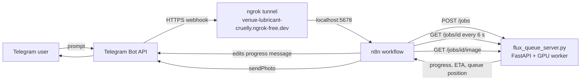

# Image-Generation-telegram-bot-Flux2_turbo-

A private Telegram bot that turns text messages into images, generated **on your own GPU** with
**FLUX.2 [dev] (4-bit) + Turbo LoRA**. Users send a description, the bot shows a live progress bar
and queue position, then delivers the picture and asks for a star rating.

It is made of two parts:

| Part | File | What it does |
|---|---|---|
| **Image server** | `flux_queue_server.py` | FastAPI app that owns the GPU. Accepts jobs, runs them one at a time in a FIFO queue, and reports progress, ETA and queue position. |
| **Telegram bot** | `telegram_flux_workflow_v8.json` | [n8n](https://n8n.io) workflow that talks to Telegram: password gate, commands, progress messages, image delivery, ratings and support notifications. |

Telegram delivers messages to n8n through a webhook, and Telegram can only call a public HTTPS address. For that reason a third piece must be running at the same time: an **ngrok tunnel** that exposes your local n8n (port `5678`) at `https://venue-lubricant-cruelly.ngrok-free.dev`. **Without ngrok the bot will not receive any messages.**



---

## Features

- **Private bot**: protected by a password. Works in private chats only, and the user's password message is deleted from the chat.
- **Brute-force protection**: configurable attempts limit and lockout time.
- **Password rotation**: change the password and every user is logged out and must enter the new one. Re-using an old password can be blocked.
- **One GPU, one image at a time**: extra requests wait in a queue (default: up to 10 waiting).
- **One active request per user**: a user cannot flood the queue.
- **Live progress message** that is edited in place: queue position, a block progress bar, estimated time left, GPU status.
- **Self-improving time estimates**: the server measures each stage and refines its estimates after every finished job.
- **Separate delivery progress** for sending the picture to Telegram.
- **Star ratings (1–5)** with inline buttons, plus an optional text comment.
- **Support notifications**: every rating, comment and delivery error is forwarded to a support person with the sender's ID, username and prompt.
- **Delivery error diagnostics**: failures are logged with a likely cause and fix, and can be listed with `/errors`.
- **Offline detection**: if the image server is down, users get a clear message instead of silence.

---

## How it works

1. The user sends a text description to the bot. Telegram forwards it to the webhook URL `https://venue-lubricant-cruelly.ngrok-free.dev`, and ngrok passes it on to n8n on port `5678`.
2. n8n checks the password / access rules (`Auth & route` node) and posts the prompt to the server: `POST /jobs`.
3. The server either rejects it (`user_busy`, `queue_full`) or puts it in the queue and returns a `job_id`.
4. n8n sends one progress message, then polls `GET /jobs/{id}` every **6 seconds** and edits that same message with the current status.
5. The server's single GPU worker runs the job in **two stages** to keep VRAM usage low:
   1. **Encode**: load only the text encoder, encode the prompt, free VRAM.
   2. **Render**: load the 4-bit transformer + VAE + Turbo LoRA, denoise in 8 steps, free VRAM.
6. When the job is `done`, n8n downloads `GET /jobs/{id}/image` and sends it to the user with `sendPhoto`.
7. The bot asks the user to rate the image with 1–5 star buttons.

Typical time for one image is about **2 minutes**. Most of that is model loading, because each job
loads the models from disk and frees them afterwards to keep VRAM available.

---

## Requirements

**Image server (GPU machine)**

- Linux or Windows with an NVIDIA GPU and a working CUDA install
- Python 3.10+
- A recent `diffusers` release that includes `Flux2Pipeline`
- `torch`, `transformers`, `accelerate`, `bitsandbytes`, `pillow`, `fastapi`, `uvicorn`
- The model files, placed locally (the server loads with `local_files_only=True`, so it never downloads at runtime):

```
models/
├── flux2-dev-bnb-4bit/                  # FLUX.2 [dev] pre-quantized to 4-bit (bitsandbytes), diffusers format
└── flux2-turbo-lora/
    └── flux.2-turbo-lora.safetensors    # Turbo LoRA
```

**Bot side**

- An [n8n](https://n8n.io) instance (self-hosted; the workflow assumes it can reach the image server)
- A Telegram bot token from [@BotFather](https://t.me/BotFather)
- **[ngrok](https://ngrok.com)**, installed and signed in with your authtoken. It gives n8n the public HTTPS address that Telegram needs, using the fixed domain `https://venue-lubricant-cruelly.ngrok-free.dev`

---

## Installation

### 1. Start the image server

```bash
git clone <your-repo-url>
cd <your-repo>

python -m venv .venv
source .venv/bin/activate          # Windows: .venv\Scripts\activate

# Install PyTorch for your CUDA version first (see pytorch.org), then:
pip install diffusers transformers accelerate bitsandbytes pillow fastapi uvicorn
```

Put the model folders in `./models/` as shown above (or edit `LOCAL_BASE_DIR` / `LOCAL_TURBO_DIR` at the top of `flux_queue_server.py`), then run:

```bash
uvicorn flux_queue_server:app --host 0.0.0.0 --port 8000
```

> ⚠️ **Always use a single worker.** Do **not** add `--workers` or `--reload`. The queue and the GPU worker live in memory inside one process; extra processes would each load their own models and have their own separate queue.

Check that it is running:

```bash
curl http://localhost:8000/health
# {"status":"ok","cuda":true,"max_concurrent":1,"running":0,"queued":0,...}
```

### 2. Create the Telegram bot

1. Open [@BotFather](https://t.me/BotFather), send `/newbot`, and follow the steps.
2. Copy the bot token.
3. In n8n: **Credentials → New → Telegram API**, paste the token.

### 3. Start n8n with the ngrok webhook URL

n8n has to know its public address. If it does not, it registers a `localhost` webhook with Telegram, which Telegram cannot reach. Set the environment variable `WEBHOOK_URL` to your ngrok domain **before** starting n8n.

Docker (example):

```bash
docker run -it --rm --name n8n \
  -p 5678:5678 \
  --add-host=host.docker.internal:host-gateway \
  -e WEBHOOK_URL=https://venue-lubricant-cruelly.ngrok-free.dev \
  -v n8n_data:/home/node/.n8n \
  docker.n8n.io/n8nio/n8n
```

npm install (Linux / macOS):

```bash
WEBHOOK_URL=https://venue-lubricant-cruelly.ngrok-free.dev n8n start
```

npm install (Windows PowerShell):

```powershell
$env:WEBHOOK_URL="https://venue-lubricant-cruelly.ngrok-free.dev"; n8n start
```

The `--add-host` line makes `host.docker.internal` work on Linux, so n8n can reach the image server on the host. It is harmless on other systems.

### 4. Start ngrok

**One-time setup:** [install ngrok](https://ngrok.com/download), then register your authtoken from the ngrok dashboard:

```bash
ngrok config add-authtoken <YOUR_NGROK_AUTHTOKEN>
```

**Every time you run the bot**, start the tunnel:

```bash
ngrok http --url=venue-lubricant-cruelly.ngrok-free.dev 5678
```

What the command does:

- `5678` is the port n8n listens on.
- `--url=venue-lubricant-cruelly.ngrok-free.dev` is the fixed ngrok domain assigned to your account, so the webhook address stays the same after every restart.
- **Keep this terminal open.** If ngrok stops, Telegram can no longer reach the bot and users get no replies.

Check that the tunnel works: open `https://venue-lubricant-cruelly.ngrok-free.dev` in a browser. You should see the n8n login or editor page. The ngrok request inspector is at `http://127.0.0.1:4040`.

> **Start order:** image server → n8n → ngrok → publish the workflow.

### 5. Import the n8n workflow

1. In n8n choose **Workflows → Import from file** and select `telegram_flux_workflow_v8.json`.
2. Open **every Telegram node** (including the Telegram Trigger) and select your bot credential. Credentials are not portable between n8n instances, so this step is required.
3. Open the **Config** node and edit the values (see the table below).
4. Make sure **n8n and ngrok are running** (steps 3 and 4), then **publish** the workflow (see the note below). Publishing is the moment n8n registers its webhook with Telegram.

> **Why publish?** The bot stores users, login attempts, ratings and the error log in n8n's workflow static data. n8n only saves that data for **published** runs, not for manual test runs. In test mode you can try the flow, but logins and reviews will not persist.

### 6. Set up the support person

The support person receives ratings, comments and delivery errors.

1. They open the bot and press **Start**. Without this, Telegram will not let the bot message them.
2. They send `/myid`. The bot replies with their numeric Telegram ID.
3. Put that ID into `supportChatId` in the **Config** node and publish again.

### 7. Try it

Open your bot in Telegram, type the password, then send a prompt, for example:

```
A lighthouse on a cliff during a thunderstorm, dramatic lighting, oil painting
```

### Every time you start the system

Three programs must be running together. Use three terminals (or run each as a service).

| # | What | Command |
|---|---|---|
| 1 | Image server | `uvicorn flux_queue_server:app --host 0.0.0.0 --port 8000` |
| 2 | n8n | `WEBHOOK_URL=https://venue-lubricant-cruelly.ngrok-free.dev n8n start` (or the Docker command from step 3) |
| 3 | ngrok tunnel | `ngrok http --url=venue-lubricant-cruelly.ngrok-free.dev 5678` |

The workflow stays published inside n8n, so it does not need to be published again after a restart.

---

## Configuration

### n8n `Config` node

| Field | Default in the workflow file | Meaning |
|---|---|---|
| `password` | `123456` | Access password users must type. **Change it before publishing.** |
| `blockPasswordReuse` | `true` | Refuse a password that was used before. Access stays paused until a new one is set. |
| `supportContact` | `@AvidMechanic` | Shown to users in error messages ("contact support"). Set this to your own handle. |
| `supportChatId` | *(empty)* | Numeric Telegram ID of the support person. Required for notifications, `/reviews` and `/errors`. |
| `serverUrl` | `http://host.docker.internal:8000` | Base URL of the image server as seen **from n8n**. |
| `maxAttempts` | `5` | Wrong passwords allowed before a lockout. |
| `lockoutMinutes` | `10` | Length of the lockout. |

> 🔐 The password is stored in plain text inside the `Config` node, and therefore in the exported JSON. **Never commit your real password to a public repository.** Keep the committed file on a placeholder and set the real value only inside n8n.

**About `serverUrl`:**

- n8n in Docker on the same machine as the server → `http://host.docker.internal:8000`. On Linux, start the n8n container with `--add-host=host.docker.internal:host-gateway`.
- n8n on the same machine without Docker → `http://localhost:8000`.
- n8n on another machine → `http://<gpu-machine-ip>:8000`.

### n8n environment

| Variable | Value | Meaning |
|---|---|---|
| `WEBHOOK_URL` | `https://venue-lubricant-cruelly.ngrok-free.dev` | Public address of n8n. It must match the domain used in the `ngrok http --url=...` command. |

### Server settings (`flux_queue_server.py`)

| Constant | Default | Meaning |
|---|---|---|
| `LOCAL_BASE_DIR` | `./models/flux2-dev-bnb-4bit` | Path of the 4-bit FLUX.2 model |
| `LOCAL_TURBO_DIR` / `TURBO_LORA_FILENAME` | `./models/flux2-turbo-lora` / `flux.2-turbo-lora.safetensors` | Turbo LoRA location |
| `DEVICE` / `DTYPE` | `cuda:0` / `bfloat16` | GPU and precision |
| `HEIGHT` × `WIDTH` | `1024 × 1024` | Output resolution |
| `NUM_INFERENCE_STEPS` | `8` | Denoising steps. Keep it in sync with `TURBO_SIGMAS` (8 values). |
| `GUIDANCE_SCALE` | `2.5` | Prompt guidance |
| `MAX_QUEUE` | `10` | How many requests may wait behind the running one |
| `KEEP_SECONDS` | `3600` | How long finished jobs and their images stay in memory |
| `OUTPUT_FORMAT` | `JPEG` | `JPEG` (small, fast to upload) or `PNG` |
| `JPEG_QUALITY` | `95` | JPEG quality |
| `STAGE_EST` | encode 45 s, load 40 s, denoise 40 s, finish 3 s | Starting time estimates. They adjust automatically after each job. |

---

## Using the bot

### Commands for everyone

| Command | What it does |
|---|---|
| *(any text)* | Treated as an image prompt (max 1500 characters). |
| `/start`, `/help` | Show the help text. |
| `/status` | Show GPU status: running now, waiting in queue, average time per image. |
| `/review <text>` | Add a comment to your most recent rating. |
| `/skip` | Skip the comment after rating. |
| `/myid` | Show your Telegram ID. Works even before login. |

### Commands for support only

These work only for the user whose ID equals `supportChatId`.

| Command | What it does |
|---|---|
| `/reviews` | The 15 most recent ratings and comments, plus the number of users with access. |
| `/errors` | The last 8 delivery errors with timestamps and causes. |

### What a user sees

1. **Login**: on first contact the bot asks for the password. The message with the password is deleted from the chat. After too many wrong attempts the user is locked out for a while.
2. **Request received**: one progress message is sent and then edited every few seconds.

   ```
   🕒 You are in the queue

   ░░░░░░░░░░░░ 0%
   👥 Requests ahead of you: 2
   ⏱ Estimated wait: about 5 min 20 s
   🖥 GPU: 1 image at a time · 2 waiting in queue
   ```

   Once the job starts, the same message changes to the current stage with a growing bar:

   ```
   🎨 Generating the image

   ████████░░░░ 67%
   ⏱ About 40 s left
   🖥 GPU: 1 image at a time · 0 waiting in queue
   ```

   The stages shown are: *Reading your prompt → Loading the image model → Generating the image → Finishing up*.
3. **Delivery**: a second message tracks sending the picture to Telegram (10% → 50% → 100% "Delivered!"). Large images over slow connections can take up to 5 minutes.
4. **Result**: the image arrives with a caption such as `🖼 Done in 1 min 52 s · seed 1234567`.
5. **Rating**: the bot shows five buttons, `1 ⭐` to `5 ⭐`. Afterwards the user may type a comment within 10 minutes, or send `/skip`. A user can tap a different star later to change the rating; an earlier comment is kept.

### Rules and rejections

- **Already generating**: *"You already have an image in progress"*. Each user can have only one active job.
- **Queue full**: *"The queue is full right now (10 of 10 places taken)"*.
- **Server offline**: *"The image server is offline right now"*.
- **Prompt too long**: the bot asks for under 1500 characters.

---

## Access control and password rotation

- The bot ignores group chats, so the password is never typed in public.
- Each login is tied to a **password version**. When you change `password` in `Config` and publish, the version increases and **all users are logged out**. They must type the new password on their next message.
- If `blockPasswordReuse` is `true` and you set a password that was used before, access stays **paused for everyone** until you set a new one. Set `blockPasswordReuse` to `false` to allow reuse.
- An empty password also pauses access.
- Support receives one message when a password change is detected, including how many users were logged out.
- Only a **salted SHA-256 fingerprint** of past passwords is kept in the saved state, not the passwords themselves.

---

## Image server API

Base URL: `http://<host>:8000` (interactive docs at `/docs`).

| Method | Path | Description |
|---|---|---|
| `POST` | `/jobs` | Submit a prompt. Always returns HTTP 200; check the `accepted` field. |
| `GET` | `/jobs/{id}` | Status, progress %, ETA, queue position. |
| `GET` | `/jobs/{id}/image` | The finished picture (404 if not ready or expired). |
| `GET` | `/queue` | Queue and GPU summary. |
| `GET` | `/health` | Liveness check, CUDA availability and queue summary. |

### Submit a job

```bash
curl -X POST http://localhost:8000/jobs \
  -H "Content-Type: application/json" \
  -d '{"prompt": "a red fox in a snowy forest, golden hour", "user": "123456", "seed": 42}'
```

| Field | Required | Notes |
|---|---|---|
| `prompt` | yes | 1–2000 characters |
| `user` | no | Identifier used to enforce one active job per user (the workflow sends the Telegram user ID). Default `anonymous`. |
| `seed` | no | Random if omitted. The workflow does not send one, so Telegram images use random seeds. |

Accepted:

```json
{
  "accepted": true,
  "job_id": "a1b2c3d4e5f6",
  "status": "queued",
  "stage": "queued",
  "stage_label": "Waiting in the queue",
  "progress_percent": 0,
  "eta_seconds": 128,
  "ahead": 0,
  "queued": 1,
  "queue_length": 1,
  "max_queue": 10,
  "seed": 42
}
```

Rejected:

```json
{ "accepted": false, "reason": "user_busy", "job_id": "a1b2c3d4e5f6" }
{ "accepted": false, "reason": "queue_full", "queued": 10, "max_queue": 10 }
```

### Poll a job

```bash
curl http://localhost:8000/jobs/a1b2c3d4e5f6
```

`status` is one of `queued`, `running`, `done`, `error`, or `not_found` (unknown or expired id).
`stage` is one of `queued`, `encode`, `load`, `denoise`, `finish`, `done`.
When `status` is `error`, the `error` field holds the exception message.

### Download the image

```bash
curl -o result.jpg http://localhost:8000/jobs/a1b2c3d4e5f6/image
```

> The server has **no authentication**. Do not expose port 8000 to the internet. Keep it on a private network or bind it to `127.0.0.1` / a firewalled interface, and let only n8n reach it.

---

## Workflow overview (n8n)

The workflow is organised around one routing step:

| Section | Nodes | Purpose |
|---|---|---|
| Entry | `Telegram Trigger` → `Config` → `Auth & route` → `Route` | Receives messages and button taps, decides what to do: `reply`, `generate`, `status` or `rate`. |
| Replies | `Send reply`, `Delete user message?`, `Copy to support?` | Sends text replies, deletes password messages, forwards comments to support. |
| Generate | `Submit job` → `Accepted?` → `Format progress` → `First update?` → `Send progress message` / `Update progress` → `Finished?` → `Wait` → `Poll job status` | Submits the job and loops every 6 s, editing one message. Gives up after about 300 polls (roughly 30 minutes). |
| Delivery | `Succeeded?` → `Sending message` → `Download image` → `Show uploading` / `Send image` → `Show delivered` | Downloads the image and sends it with a delivery progress message. |
| Ratings | `Ask for review`, `Get job info` → `Save review` → `Answer button tap` → `Update rating message` → `Notify support?` | Handles star buttons (`rate:<jobId>:<1-5>`) and stores the review. |
| Errors | `Log delivery error` → `Delivery failed` / `Log to support?` | Builds a readable error with a likely cause, stores the last 20, notifies support. |
| Status | `Get queue` → `Send queue status` | Answers `/status`. |

---

## Data stored by the workflow

Stored in n8n workflow static data (published runs only):

- Users: username, name, chat ID, first and latest access time, password version, and up to the last 200 reviews each
- Login attempts and lockouts
- Password history fingerprints and a short change log
- The last 20 delivery errors

Not stored by n8n: prompts and images. The image server keeps finished jobs and pictures **in memory** for `KEEP_SECONDS` (1 hour by default), then deletes them.

---

## Troubleshooting

| Problem | Likely cause and fix |
|---|---|
| Bot never answers | The workflow is not published, **ngrok is not running**, or n8n was started without `WEBHOOK_URL`. Check that `https://venue-lubricant-cruelly.ngrok-free.dev` opens n8n in a browser. |
| Publishing fails with a webhook / HTTPS error | n8n was started without `WEBHOOK_URL=https://venue-lubricant-cruelly.ngrok-free.dev`, or ngrok is not running. Stop n8n, set the variable, start n8n again, make sure ngrok is up, then publish again. |
| ngrok says authentication failed | The authtoken is missing or wrong. Run `ngrok config add-authtoken <YOUR_NGROK_AUTHTOKEN>`. |
| ngrok says the domain / endpoint is already online | Another ngrok session is still using the same domain. Close it (another terminal, another computer, or a background service) and start again. |
| Bot worked yesterday but not today | ngrok or n8n was closed. Follow *Every time you start the system*. |
| "Image server is offline" | `flux_queue_server.py` is not running, or `serverUrl` is wrong. On Linux Docker, add `--add-host=host.docker.internal:host-gateway`. |
| Users have to log in again after a restart or test run | Static data is only saved by **published** runs. |
| Everyone was logged out | The password in `Config` changed. This is intended; see *Password rotation*. |
| "Access is paused" for everyone | The password is empty, or was used before while `blockPasswordReuse` is on. Set a new password. |
| Bot keeps saying "Still working…" | The server may have crashed mid-job (a restart also drops the in-memory queue). After about 30 minutes of polling the bot gives up with an error message. Restart the server and send the prompt again. |
| "Something went wrong while generating" | The job ended in `error` or was not found. Check the server console: the traceback is printed there. A common cause is running out of VRAM. |
| Delivery failed with an error code | Run `/errors` as support. Typical causes: image larger than Telegram's photo limits (use JPEG or switch `Send image` to `sendDocument`), user blocked the bot, or a timeout on slow connections. |
| Support gets no notifications | `supportChatId` is empty, or the support person never pressed **Start** on the bot. |
| Second job never starts | You are running multiple uvicorn workers or `--reload`. Use one process. |

---

## Security notes

- Change the default password before publishing the workflow.
- Do not commit a real password or bot token. Credentials are kept in n8n, not in the workflow file, but the password lives in the `Config` node.
- Keep the image server on a private network; it has no authentication.
- The ngrok tunnel makes **all of n8n** reachable at `https://venue-lubricant-cruelly.ngrok-free.dev`, including the editor login page. Use a strong password for your n8n owner account, and stop the tunnel when the bot is not needed.
- The bot only works in private chats, so the password is never typed in groups.

---

## Project structure

```
.
├── flux_queue_server.py            # FastAPI queue + FLUX.2 pipeline
├── telegram_flux_workflow_v8.json  # n8n workflow (import into n8n)
└── README.md
```

## License

Add your license here. Note that the FLUX.2 [dev] model weights and the Turbo LoRA have their **own licenses**; check their terms before any commercial use.
